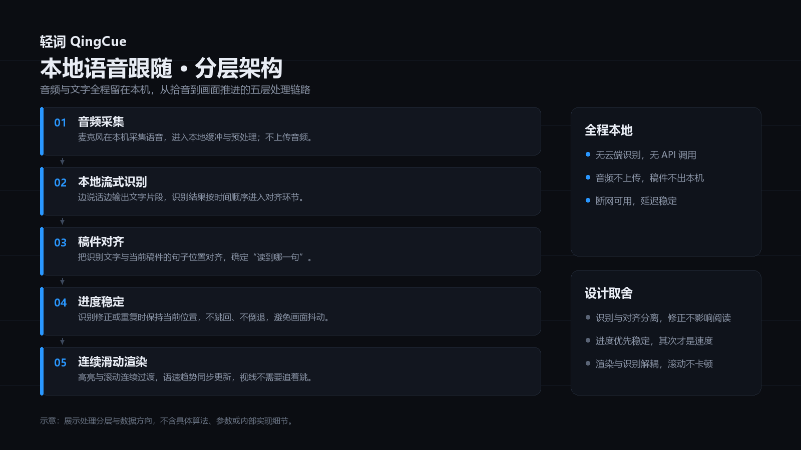
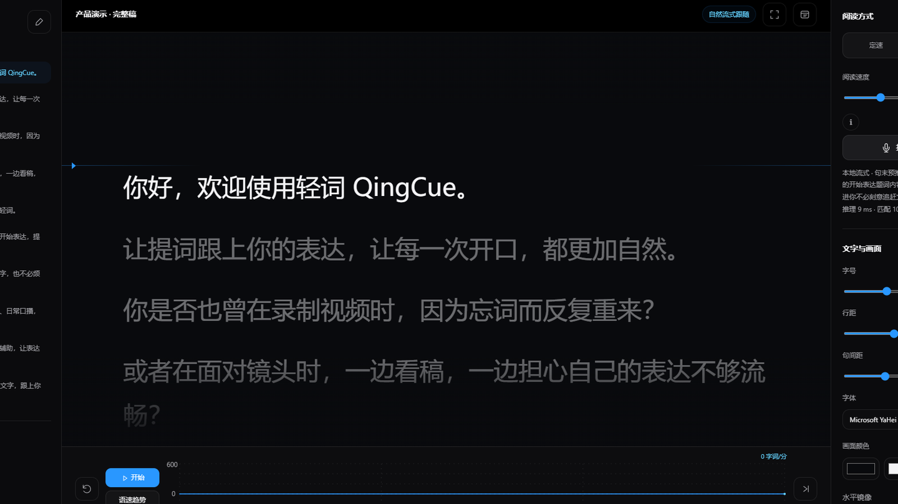
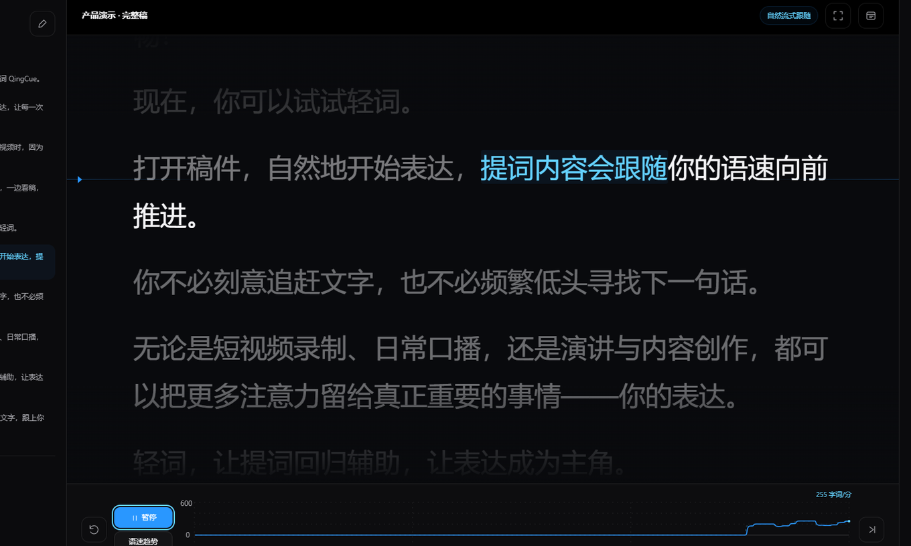
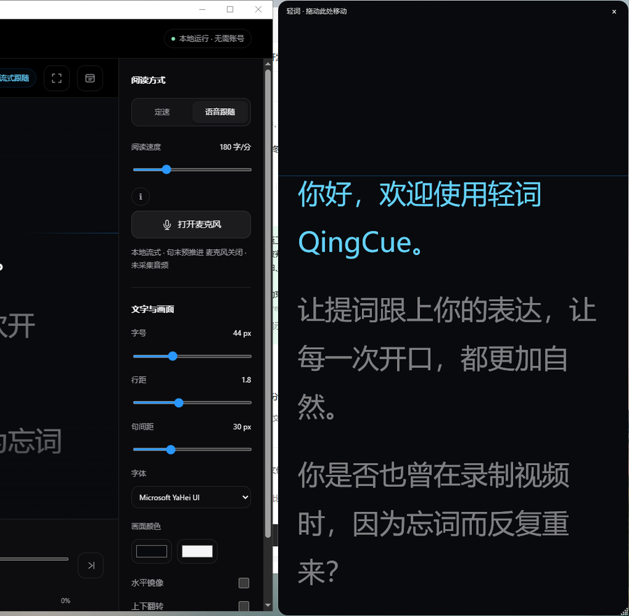
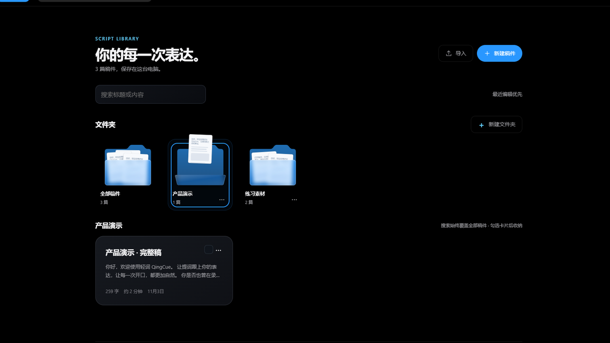

<p align="center">
  
</p>

<h1 align="center">轻词 QingCue</h1>

<p align="center"><strong>让文字，跟上你的表达。</strong></p>

<p align="center">Windows 桌面提词器：稿子在眼前，进度跟着你的语速走，声音与文字都留在本机。</p>

<p align="center">
  <a href="https://github.com/jaychou1669/QingCue-Downloads/releases/tag/v0.1.17-r13.3"><strong>下载 Windows 版</strong></a>
  &nbsp;·&nbsp; <code>v0.1.17-r13.3</code> &nbsp;·&nbsp; Windows 10 / 11 x64
</p>

<p align="center">
  
  
</p>

<p align="center"><sub>当前为候选试用版本：安装链路已完成自动化验证，功能与真人朗读的正式验收尚未完成。</sub></p>

---

## 把稿件放在眼前

<p align="center">
  
</p>

左侧是稿件目录与句子列表，中间是当前句与上下文，右侧是文字与画面参数，底部是进度与语速趋势。开场前三十秒，视线就已经落在该看的地方。

---

## 核心功能

### 自然语音跟随


你按自己的节奏说，提词按你的语速推进。停顿、回看或重复一句，位置不会乱跳。

<sub>画面为回放样本驱动的真实运行截图，非真人朗读。</sub>

### 逐词滑动


高亮跟着词走，而不是整段跳变。前后文始终留在视野里，眼睛不用来回找下一句。

### 悬浮提词


独立置顶窗口，放在镜头旁边也不遮挡主要内容；位置和大小都可以自己调。

### 稿件管理


稿件、文件夹与展开状态一目了然。分类只是本地整理，稿件内容不会被改写。

### 个性化设置


模型、麦克风、跟随方式集中在一处；字号、行距、段间距与画面颜色在工作台右侧随手可调。

---

## 动态演示

<p align="center">
  
</p>

<p align="center"><sub><strong>演示由回放样本驱动，非真人朗读。</strong>样本音频由本机语音合成生成，画面为真实应用录制，未做静态拼帧。</sub></p>

- **开口即跟随**：开始后第一句立即进入跟随状态，不需要预热。
- **停顿后可续读**：短暂停顿不会丢位置，接着读会从当前句继续。
- **下一句自然衔接**：当前句结束时高亮前移，底部语速趋势同步变化。

---

## 核心技术

<p align="center">
  
</p>

音频采集 → 本地流式识别 → 稿件对齐 → 进度稳定 → 连续滑动渲染。五层之间只传递必要的结果，识别与渲染互不阻塞。

- **本地语音处理**：音频不出本机，识别在本机完成，断网也能继续用。
- **流式识别与稿件对齐**：边说话边出字，再把文字对回稿件的句子位置。
- **识别修正下的进度稳定**：识别结果被修正或重复时，阅读位置保持不回退。
- **连续滑动与视觉同步**：位置变化以连续滚动呈现，趋势与进度同步更新。
- **朗读异常容错**：漏读、跳读、重复朗读都不会让画面失控。
- **低延迟切换**：换句时不需要额外等待。

<sub>以上只说明处理分层与工程取舍，不涉及具体算法、参数或内部实现细节。</sub>

---

## 使用场景

### 短视频口播



一条接一条地录，稿子跟得上语速，重录次数明显变少。

### 视频录制



面对镜头不用低头找词，视线留在镜头上，表达更连贯。

### 日常演讲



把悬浮窗放在视线边缘，台上不用背稿，也不会读成念稿。

### 内容创作



边想边录，稿件按文件夹收好，下一次接着写、接着录。

---

## 下载与安装

- 版本：`v0.1.17-r13.3`（候选试用）
- 系统：Windows 10 / Windows 11，x64
- 安装包：[QingCue-0.1.17-r13.3-e469484-win-x64.msi](https://github.com/jaychou1669/QingCue-Downloads/releases/download/v0.1.17-r13.3/QingCue-0.1.17-r13.3-e469484-win-x64.msi)（434,040,993 B）
- 校验文件：[SHA256SUMS.txt](https://github.com/jaychou1669/QingCue-Downloads/releases/download/v0.1.17-r13.3/SHA256SUMS.txt)

安装包 SHA-256：

```
9305BBFC7D29B4460F0C71048B7718D9EC44D02F9CB1C39230716850741014EC
```

安装：双击 MSI，按向导完成。安装包尚未做商业代码签名，Windows 可能弹出 SmartScreen 提示；确认文件来自本仓库并核对 SHA-256 后，选择「更多信息 → 仍要运行」。

卸载：Windows 设置 → 应用 → 已安装的应用 → 轻词 QingCue → 卸载。卸载会保留 `%LOCALAPPDATA%\QingCue` 下的稿件与本地模型，彻底清理可在卸载后手动删除该目录。

> 候选试用版本可交付试用，不构成正式发布。安装生命周期已做自动化验证，仅代表安装链路，不代表功能与真人朗读验收。

---

## 技术文档与常见问题

- [ARCHITECTURE.md](docs/ARCHITECTURE.md)：整体分层与各层职责
- [CAPABILITIES.md](docs/CAPABILITIES.md)：能力边界与适用场景
- [TECHNOLOGY.md](docs/TECHNOLOGY.md)：技术难点的抽象说明
- [TESTING.md](docs/TESTING.md)：已验证结论与未验证清单

**麦克风没有反应？** 在 Windows「设置 → 隐私和安全性 → 麦克风」中允许桌面应用访问，并在应用内选择正确的输入设备。

**一定要下载模型吗？** 普通定速提词不需要模型；语音跟随需要本机语音模型，可在「设置」中下载或导入。

**卸载后还有残留？** 卸载会保留 `%LOCALAPPDATA%\QingCue`，需要彻底清理时手动删除该目录。

**怎么反馈问题？** 通过 [Issues](https://github.com/jaychou1669/QingCue-Downloads/issues) 反馈，附版本号、Windows 版本与复现步骤；请勿上传包含个人信息的稿件或录音。

---

<p align="center"><sub>轻词 QingCue · 候选试用版 · 2026</sub></p>
