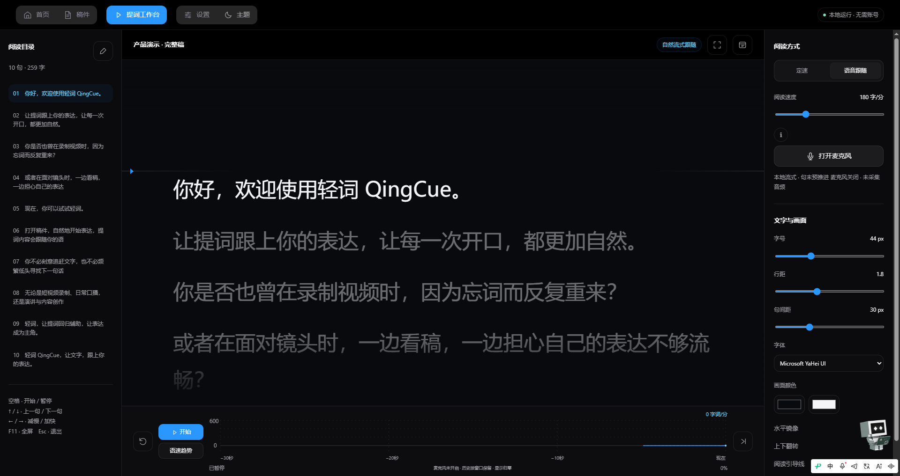
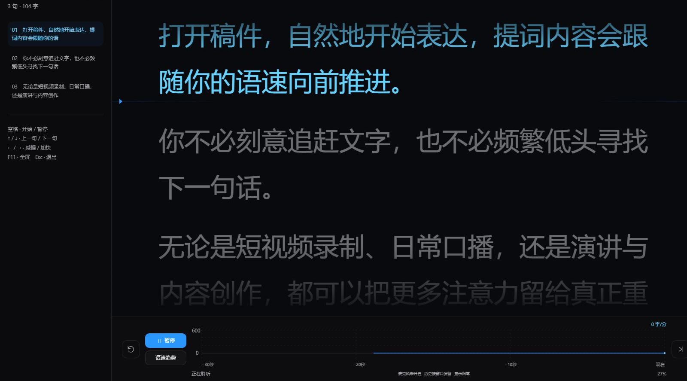
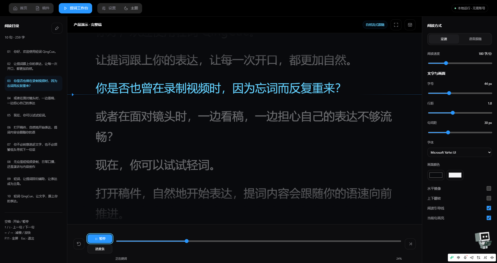
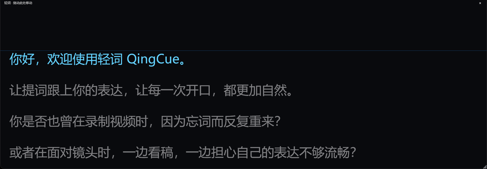
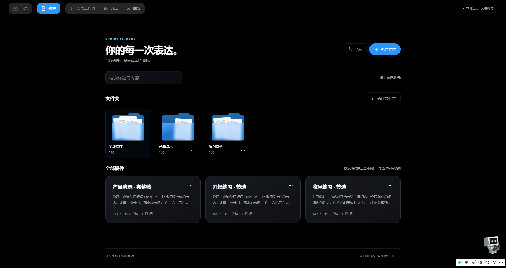
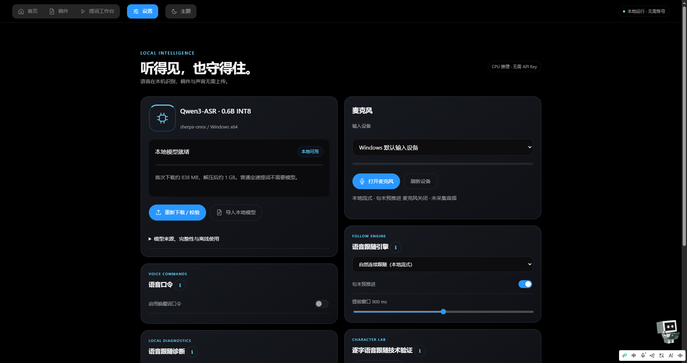
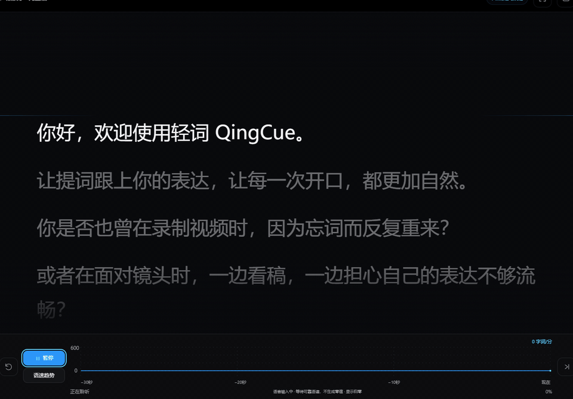

<p align="center">
  
</p>

<h1 align="center">轻词 QingCue</h1>

<p align="center"><strong>让文字，跟上你的表达。</strong></p>

<p align="center">离线语音跟随提词器 · Windows 桌面端 · 语音与提词处理均在本机完成</p>

<p align="center">
  <a href="https://github.com/jaychou1669/QingCue-Downloads/releases/tag/v0.1.17-r13.3"><strong>下载 Windows 版</strong></a>
  &nbsp;·&nbsp; 最新版本 <code>v0.1.17-r13.3</code> &nbsp;·&nbsp; Windows 10 / 11 x64
</p>

<p align="center">
  
  
  
</p>

<p align="center"><sub>当前为<strong>候选试用版本</strong>：安装链路已做自动化验证，功能与真人现场朗读尚未完成正式验收。</sub></p>

---

## 把稿件放在眼前

<p align="center">
  
</p>

<p align="center"><sub>提词工作台：左侧稿件目录、中间的当前句与上下文、右侧文字与画面设置，底部为语速趋势与控制栏。</sub></p>

---

## 功能

<table>
<tr>
<td width="50%" valign="top">
  
  <p><strong>自然语音跟随提词</strong><br>
  开口说话，提词按你的语速向前推进；停顿、回看或重复，位置都不会乱。<br>
  <sub>画面取自回放演示，非真人朗读。</sub></p>
</td>
<td width="50%" valign="top">
  
  <p><strong>实时文字滑动</strong><br>
  当前句高亮，前后文保留在视野内；定速模式下也能按设定节奏匀速推进。</p>
</td>
</tr>
<tr>
<td width="50%" valign="top">
  
  <p><strong>悬浮提词</strong><br>
  独立置顶悬浮窗，可拖动、可缩放，放在镜头旁也能看清当前句。</p>
</td>
<td width="50%" valign="top">
  
  <p><strong>稿件与文件夹管理</strong><br>
  新建、导入、分类整理；稿件与设置只保存在本机。<br>
  <sub>截图使用公开演示稿，未使用个人稿件。</sub></p>
</td>
</tr>
<tr>
<td width="50%" valign="top">
  
  <p><strong>设置与本地能力</strong><br>
  模型、麦克风、跟随引擎、诊断与快捷键集中在一处；字号、行距、字体与高亮在工作台右侧调整。</p>
</td>
<td width="50%" valign="top">
  
  <p><strong>语音跟随诊断</strong><br>
  默认关闭，需要时手动开启；用于记录跟随过程与排查设备、识别问题。</p>
</td>
</tr>
</table>

---

## 动态演示

<p align="center">
  
</p>

<p align="center"><sub>逐词跟随的真实运行画面：当前句随语音推进高亮，底部语速趋势同步变化。<br>
<strong>演示由回放样本驱动，非真人朗读</strong>；样本音频由本机语音合成生成，画面为真实应用录制。</sub></p>

---

## 使用流程

1. **打开软件**：安装后启动轻词 QingCue。语音跟随需要本机语音模型，可在「设置」中下载或导入；普通定速提词不需要模型。
2. **导入稿件**：在「稿件」中新建或导入文稿，可按文件夹分类整理。
3. **开始表达**：进入「提词工作台」，选择定速或语音跟随，点击「开始」。
4. **文字自动跟随**：正常开口表达，提词随语速向前推进；需要时打开悬浮提词窗。

---

## 下载与安装

<p align="center">
  <a href="https://github.com/jaychou1669/QingCue-Downloads/releases/tag/v0.1.17-r13.3"><strong>前往 Release 下载 v0.1.17-r13.3</strong></a>
</p>

| 文件 | 说明 |
| --- | --- |
| [QingCue-0.1.17-r13.3-e469484-win-x64.msi](https://github.com/jaychou1669/QingCue-Downloads/releases/download/v0.1.17-r13.3/QingCue-0.1.17-r13.3-e469484-win-x64.msi) | Windows x64 安装包（434,040,993 B） |
| [SHA256SUMS.txt](https://github.com/jaychou1669/QingCue-Downloads/releases/download/v0.1.17-r13.3/SHA256SUMS.txt) | 安装包校验文件 |

安装包 SHA-256：

```
9305BBFC7D29B4460F0C71048B7718D9EC44D02F9CB1C39230716850741014EC
```

校验方式（PowerShell）：

```powershell
Get-FileHash .\QingCue-0.1.17-r13.3-e469484-win-x64.msi -Algorithm SHA256
```

**安装**：双击 MSI，按向导完成安装。安装包尚未做商业代码签名，Windows 可能提示 SmartScreen；确认文件来自本仓库并核对 SHA-256 后，可选择「更多信息 → 仍要运行」。

**卸载**：Windows 设置 → 应用 → 已安装的应用 → 轻词 QingCue → 卸载。卸载会保留 `%LOCALAPPDATA%\QingCue` 下的稿件与本地模型；如需彻底清理，可在卸载后手动删除该目录。

**系统要求**：Windows 10 / Windows 11，x64。

> 当前为**候选试用版本**：可交付试用，不构成正式发布。安装生命周期已做自动化验证，仅代表安装链路，不代表功能与真人朗读验收。

---

## 技术说明

- [ARCHITECTURE.md](docs/ARCHITECTURE.md)：整体分层与各层职责。
- [CAPABILITIES.md](docs/CAPABILITIES.md)：能力边界、适用场景与实验性范围。
- [TECHNOLOGY.md](docs/TECHNOLOGY.md)：技术难点的抽象说明。
- [TESTING.md](docs/TESTING.md)：已验证结论与未验证清单。

---

## 常见问题与反馈

**安装时被 SmartScreen 拦截？**
安装包尚未做商业代码签名。请先核对 SHA-256，再选择「更多信息 → 仍要运行」。

**麦克风没有反应？**
在 Windows「设置 → 隐私和安全性 → 麦克风」中允许桌面应用访问麦克风，并在应用内选择正确的输入设备。

**卸载后还有残留？**
卸载会保留 `%LOCALAPPDATA%\QingCue`（稿件与本地模型）。需要彻底清理时，卸载后手动删除该目录。

**如何反馈问题？**
请通过本仓库的 [Issues](https://github.com/jaychou1669/QingCue-Downloads/issues) 反馈，并附上版本号、Windows 版本与复现步骤；请勿上传包含个人信息的稿件或录音。

---

<p align="center"><sub>轻词 QingCue · 候选试用版 · 2026</sub></p>
