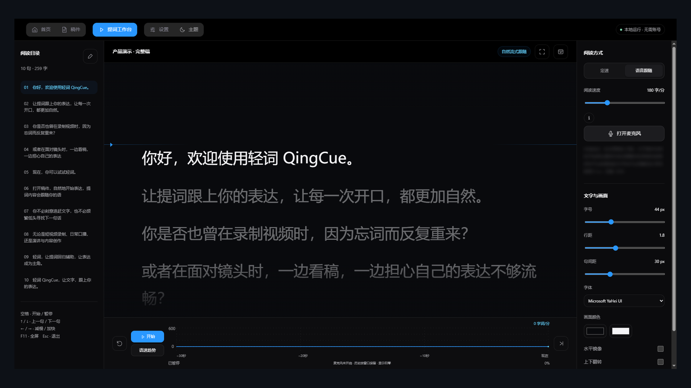
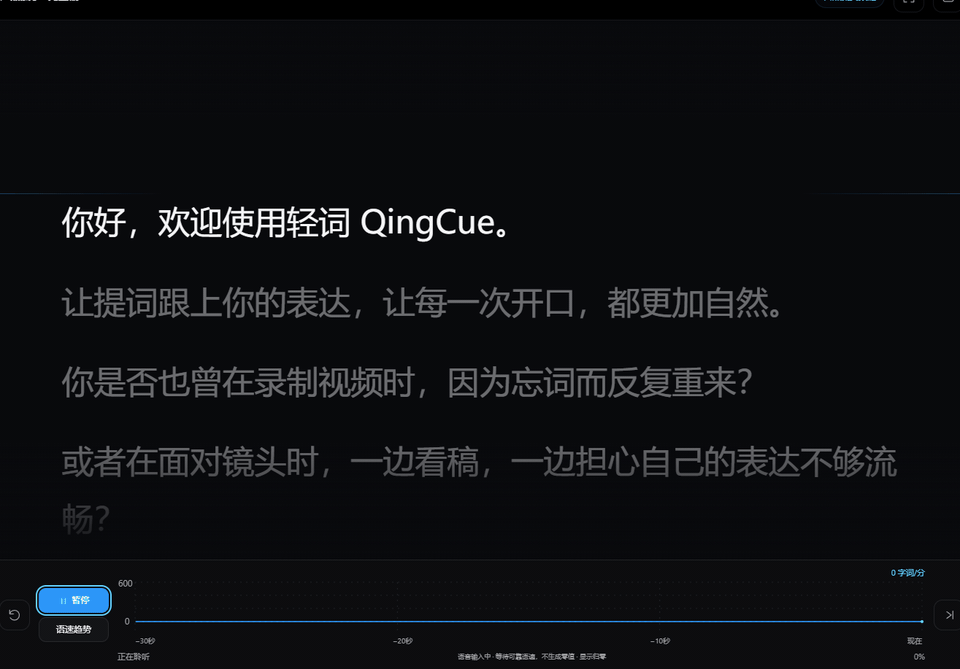
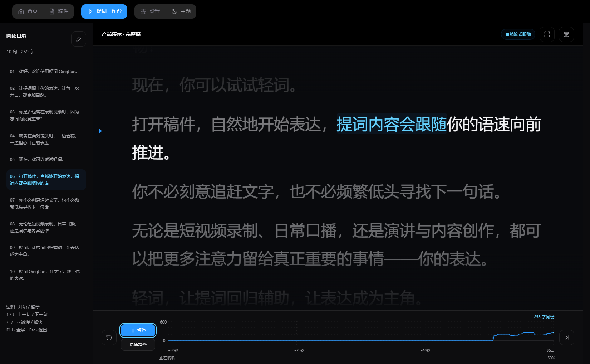
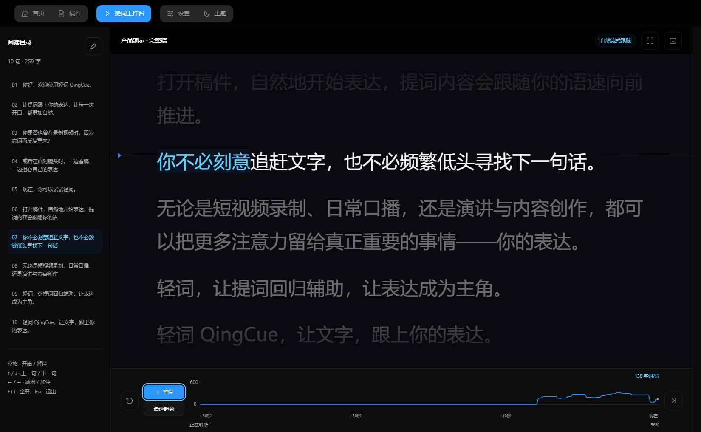
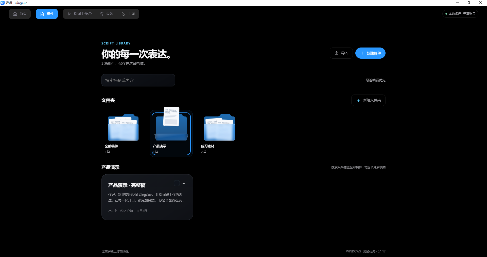
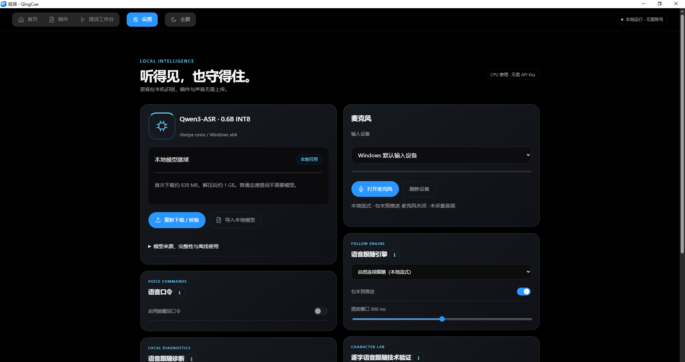
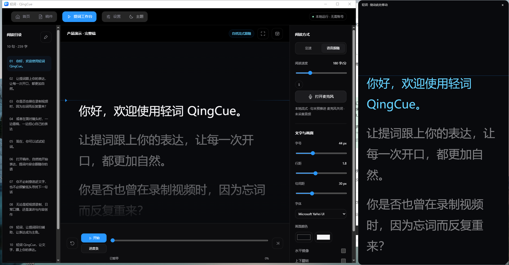

<p align="center">
  
</p>

<h1 align="center">轻词 QingCue</h1>

<p align="center"><strong>让文字配合你的表达。</strong></p>

<p align="center">轻词 QingCue 是一款 Windows 桌面自然语音跟随提词器：按自己的节奏说话，稿件随声音实时同步，表达与文字始终同拍。</p>

<p align="center">
  <a href="https://github.com/ShowKang/QingCue-Teleprompter/releases/tag/v0.1.17-r13.3"><strong>下载 Windows 版</strong></a>
  &nbsp;·&nbsp; <code>0.1.17 + r13.3</code> &nbsp;·&nbsp; Windows 10 / 11 · x64
</p>

<p align="center">
  
  
</p>

<p align="center"><a href="./README.md">English</a> | <strong>简体中文</strong></p>

---

## 为什么选择轻词 QingCue

对着稿子念，往往意味着要在「内容」和「观众」之间做取舍。轻词 QingCue 把这个取舍拿掉：稿件始终在视线前方，高亮跟着你的声音走，而不是跟着计时器或脚踏板走。

- **语速由你决定。** 说快一点、慢一点、停下来、重复一句，画面都跟着你，不需要迁就预设速度。
- **视线留在该在的地方。** 当前句始终清晰，下一句已经进入视野，不必在一行字里反复找位置。
- **声音不出本机。** 麦克风音频、语音识别与稿件数据都留在你的电脑上，没有账号，也没有云端往返。
- **一次配置，之后可离线。** 主语音模型下载完成后，断网不影响提词与语音跟随。

<p align="center">
  
</p>

稿件目录、当前句、上下文、阅读参数与进度都在同一个窗口里，打开应用就能直接进入朗读状态。

---

## 动态演示

<p align="center">
  
</p>

<p align="center"><sub><strong>演示由本地生成的回放样本驱动，非真人朗读。</strong>界面为应用连续录制，未做静态拼帧。</sub></p>

这段演示对应最关键的四个动作：开口后高亮开始移动，停顿时画面停住，重新开口从原处继续，读完当前句后自然过渡到下一句。

---

## 核心功能

| 功能 | 说明 |
| --- | --- |
| **自然语音跟随** | 按真实语速推进高亮与滚动，不需要脚踏板、遥控器或手动翻页。 |
| **词级高亮** | 高亮以词为单位前移，读到哪儿就亮到哪儿，视线不必在一整行里来回寻找。 |
| **连续文本跟随** | 句子之间连续滚动，跨句衔接不打断阅读节奏，阅读位置保持稳定。 |
| **跨句自动衔接** | 当前句读完，高亮前移并滚动到下一句，衔接处不出现可见跳动。 |
| **停顿与重复容错** | 停顿时画面停在原处；重复、回读与即时改口都锚定在当前句，不会跑到后面。 |
| **定速提词** | 关闭语音跟随时按设定节奏推进，不需要模型，也不占用麦克风。 |
| **悬浮提词窗口** | 独立置顶窗口，可放在镜头或录制软件旁边，不必在窗口之间切换视线。 |
| **稿件管理** | 导入纯文本与 Markdown，按文件夹归类，原文内容不被改写。 |
| **个性化阅读设置** | 字号、行距、段间距、画面配色与跟随方式均可按屏幕与观看距离调整。 |
| **本地语音识别与诊断** | 语音在本机完成识别，不上传音频；同时显示麦克风与识别状态，便于排查输入问题。 |

语音跟随使用本地语音引擎；模型尚未就绪时，定速提词仍可用于试读与排练。

---

## 自然语音跟随的工作方式

1. **开口即开始。** 按下开始后按平常语速朗读，当前句很快就会进入高亮状态。
2. **停顿不丢位。** 思考、喝水、看提示的间隙，画面停在原地；重新开口后从同一句继续。
3. **重复与改口不跑偏。** 重复一句、临时换个说法，进度仍锚定在当前句，不会跳到后面。
4. **读完即衔接。** 当前句读完，高亮前移并滚动到下一句，下一句在切换前就已准备好。

轻词的取舍很明确：**宁可慢半拍，不可乱跳**。语音证据不充分时，画面倾向于停在原位，而不是猜测一个位置。短暂滞后对表达的干扰，远小于跳到错误的一行。

<p align="center">
  
</p>

句子与段落是定位锚点，词是推进单位。流式识别结果会在朗读过程中被修正，而轻词保证已经呈现的阅读位置**只前进或停留，不回退**，修正带来的偏差会在后续朗读中平滑消化。

<p align="center">
  
</p>

滚动采用有界视口跟随：高亮接近可读区边缘时才推动画面，前后文始终留在视野中。快读时画面平稳，停顿时画面静止。

---

## 界面细节

<p align="center">
  
</p>

稿件按文件夹组织，目录可以展开与收起。分类只是本机的整理方式，不会改写原文；纯文本与 Markdown 按文本语义处理，复杂排版不做保真还原。

<p align="center">
  
</p>

设置把影响「跟得住」与「看得清」的参数分开：输入设备、跟随方式与本地模型管理放在一起；字号、行距、段间距、配色与高亮样式放在另一边。

<p align="center">
  
</p>

悬浮窗口独立置顶，大小与位置可调，适合放在镜头旁或副屏边缘，不遮挡主界面。

---

## 使用场景

- **短视频口播。** 镜头前往往只有一次机会，稿件在视线内，注意力留给表情、语气与镜头。
- **视频录制。** 重录时可以自然停下，继续时不用腾出手找回位置。
- **演讲与分享。** 下一句始终可见，视线可以留给台下的人，而不是屏幕上的行。
- **写稿与试读。** 写、改、读在同一处完成，长稿也能靠文件夹与阅读位置快速定位。

---

## 隐私与本地处理

- **音频留在本机。** 麦克风输入只在内存中处理，不录音存档、不上传、不用于任何训练。
- **识别在本机完成。** 链路中没有云端语音服务，也没有第三方持有你的录音。
- **稿件留在本机。** 稿件、文件夹、设置与诊断数据保存在你的用户目录，不存在账号体系与云端同步。
- **不采集朗读内容。** 应用不会归档转写结果，也不会对朗读质量打分或评价。
- **离线可用。** 主语音模型就绪后，断网不影响提词与跟随。

---

## 系统要求

| 项目 | 要求 |
| --- | --- |
| 操作系统 | Windows 10 / 11，64 位 |
| 架构 | x64 |
| 安装格式 | MSI |
| 运行环境 | 安装包自包含，无需另装运行时或 VC++ 运行库 |
| 显示 | 建议 1920×1080 及以上；字号与间距可调整 |
| 音频 | 麦克风或其他输入设备（仅语音跟随需要） |
| 磁盘 | 应用约 1 GB；主语音模型另需约 900 MB |
| 网络 | 仅首次下载模型时需要；之后可离线 |

---

## 下载与安装

在 [Release 页面](https://github.com/ShowKang/QingCue-Teleprompter/releases/tag/v0.1.17-r13.3) 获取安装文件：

- **轻词 QingCue 0.1.17 + r13.3（Windows x64）** — MSI 安装包，434,040,993 字节（约 414 MB）
- `SHA256SUMS.txt` — 校验文件
- `LICENSES-v0.1.17-r13.3.md` — 第三方许可与版权说明

**安装**

1. 下载 MSI 与 `SHA256SUMS.txt`。
2. 按下方 [SHA-256 校验](#sha-256-校验) 核对安装包。
3. 双击 MSI 按向导安装；也支持命令行安装：

   ```bat
   msiexec /i "<下载的安装包>.msi"
   ```

4. 从开始菜单或桌面入口启动轻词 QingCue。

安装到当前用户目录，并创建开始菜单与桌面入口。

> 安装包未做商业代码签名，Windows 可能显示 SmartScreen 提示。请先确认文件来自本仓库并完成 SHA-256 校验，再选择「更多信息 → 仍要运行」；不建议为此关闭系统安全检查。

**升级** — 直接运行更新的 MSI 覆盖安装，稿件、设置与本地模型都会保留。

**卸载** — Windows「设置 → 应用 → 已安装的应用」中找到轻词 QingCue 并卸载。`%LOCALAPPDATA%\QingCue` 默认保留，需要彻底清理时请手动删除。

**便携使用** — 在程序旁放置 `portable.flag`，数据会写入同目录的 `Data`；移动前请先退出程序。

---

## 首次使用

1. **选择麦克风。** 在设置中选择输入设备，对着麦克风说话确认输入电平有变化。
2. **下载主语音模型。** 按提示在应用内下载（约 900 MB）。安装包内置两套小型入门模型（合计约 101.7 MB），主模型提供更完整的跟随效果。
3. **打开或导入稿件**，按开始后朗读一小段。
4. **调整阅读参数**：字号、行距、间距与配色，按屏幕和观看距离设置。
5. **尝试悬浮窗口**：需要与录制或直播软件并排时使用。

定速提词无需模型与麦克风，安装后即可使用。

---

## 常见问题

**语音跟随没有反应？**

先在 Windows「设置 → 隐私和安全性 → 麦克风」允许桌面应用访问麦克风，再在轻词内选择正确的输入设备，并确认主语音模型已下载完成。

**一定要下载模型吗？**

语音跟随需要主模型：安装包内置两套小型入门模型，主模型约 900 MB，首次在应用内下载。定速提词不需要模型，也不占用麦克风。

**可以离线使用吗？**

可以。主模型就绪后，提词、跟随与稿件管理都与网络无关；只有首次下载模型需要联网。

**换电脑还要重新下载模型吗？**

可以把模型从数据目录复制出来，在新环境的设置中导入。

**朗读内容和稿件不一致会怎样？**

进度以稿件为锚、以朗读为证据：重复、回读与即时改口都会留在当前句；跳过内容时会在读到后文后赶上。长时间脱离稿件自由发挥可能让画面停在原处，回到稿件后继续推进。

**卸载会删掉稿件吗？**

不会。卸载默认保留 `%LOCALAPPDATA%\QingCue`（稿件、设置与模型）；需要彻底清理时手动删除该目录。

**在哪里反馈问题？**

在 [GitHub Issues](https://github.com/ShowKang/QingCue-Teleprompter/issues) 选择缺陷报告或安装求助模板，附上版本号、Windows 版本与复现步骤。请勿上传包含个人或机密信息的稿件与录音。

---

## SHA-256 校验

`0.1.17 + r13.3` 版 Windows x64 安装包的 SHA-256：

```
9305BBFC7D29B4460F0C71048B7718D9EC44D02F9CB1C39230716850741014EC
```

在下载目录执行：

```powershell
$msi = Get-ChildItem .\QingCue-0.1.17-r13.3-*.msi | Select-Object -First 1
Get-FileHash $msi.FullName -Algorithm SHA256
```

也可以在命令提示符执行 `certutil -hashfile <下载的安装包>.msi SHA256`。

输出与上方值一致即表示文件完整；不一致请重新下载，不要继续安装。Release 页面同时提供 `SHA256SUMS.txt`。

---

## 版本更新

**0.1.17 + r13.3** — 安装与分发修订版本，提词与语音跟随能力不变。补齐第三方许可与版权文件，提供 SHA-256 校验与安装包溯源信息；覆盖升级会保留稿件、设置与本地模型。

完整历史见 [CHANGELOG.md](./CHANGELOG.md)。

---

## AI 辅助开发工具

轻词 QingCue 的开发过程得到了现代 AI 辅助开发工具的支持。

<table align="center">
  <tr>
    <td align="center" width="33%">
      <picture>
        <source media="(prefers-color-scheme: dark)" srcset="./assets/brand/ai-tools/openai-wordmark-white.svg">
        
      </picture>
      <br>
      <sub><strong>Codex</strong> · OpenAI</sub>
    </td>
    <td align="center" width="33%">
      <picture>
        <source media="(prefers-color-scheme: dark)" srcset="./assets/brand/ai-tools/claude-wordmark-ivory.svg">
        
      </picture>
      <br>
      <sub><strong>Claude</strong> · Anthropic</sub>
    </td>
    <td align="center" width="33%">
      <strong>TRAE CN</strong>
      <br>
      <sub>TRAE</sub>
    </td>
  </tr>
  <tr>
    <td align="center" colspan="3" width="500">
      <sub>TRAE CN 官方品牌素材待确认，当前以品牌文字展示。</sub>
    </td>
  </tr>
</table>

---

## 技术支持与反馈

- **缺陷反馈与安装求助**：[GitHub Issues](https://github.com/ShowKang/QingCue-Teleprompter/issues)
- **安装细节**：[docs/INSTALL.md](./docs/INSTALL.md)
- **能力范围与边界**：[docs/CAPABILITIES.md](./docs/CAPABILITIES.md)

反馈以 GitHub 公开渠道为准。提交问题时请附版本号、Windows 版本与复现步骤。

---

<p align="center"><sub>轻词 QingCue · Windows 10 / 11 · x64 · 2026</sub></p>
