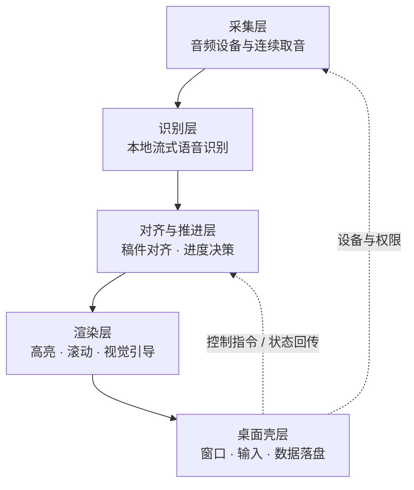

# 技术架构

面向希望理解系统构成的开发者。本文描述技术选型、五层职责、层间数据流与关键取舍；
涉及算法步骤、参数取值、内部命名与源码结构的内容不在此展开。

## 1. 技术栈

| 环节 | 选型 | 选择理由 |
| --- | --- | --- |
| 桌面壳层 | .NET 8 / WPF（Windows x64） | 原生窗口、置顶、单实例与系统集成成熟；自包含分发，用户机器无需预装运行时 |
| 界面层 | WebView2（固定版本随包分发） | 本地 Web 视图负责排版与连续动效；壳层经消息通道驱动，不依赖外部网络 |
| 流式语音识别 | sherpa-onnx 1.13.8 + ONNX Runtime 1.28.2 | 纯本地、可在 CPU 上运行的流式推理运行时，不引入云端依赖 |
| 声学模型 | Qwen3-ASR 0.6B INT8 | 0.6B 参数并以 INT8 量化，在普通办公机上兼顾识别质量与内存、算力占用 |
| 本地存储 | 文件 + SQLite | 稿件、设置与诊断数据留在本机，无服务端 |
| 分发 | MSI（每用户安装） | 自包含运行时与固定版 WebView2，减少环境差异 |

识别模型与核心功能解耦：未启用语音跟随时不加载模型；首次启用需联网获取，之后可离线运行。

## 2. 设计目标

QingCue 是离线运行的语音跟随提词器：按稿件朗读，界面按朗读进度推进高亮与滚动，
不需要脚踏板、遥控器或人工翻页。由此产生四条架构约束：

1. **纯本地**：采集、识别、对齐、推进全部在本机完成。
2. **实时**：从开口到画面更新必须落在人的感知可接受范围内，任何一层都不能引入可累积的排队延迟。
3. **单向推进**：识别结果会修正，视觉进度必须只前进或停留，不回退。
4. **可退化**：麦克风、模型或识别链路不可用时，仍可作为定速提词器工作。

## 3. 五层结构

| 层 | 职责 | 解决的工程问题 | 用户可感知的效果 |
| --- | --- | --- | --- |
| 采集层 | 选择并打开输入设备、连续取音、统一设备格式、区分「有人声 / 无人声」以切分发言段 | 设备差异、格式不一致、长时间运行不丢帧 | 接上麦克风即可用；长时间朗读不中断 |
| 识别层 | 在本机加载声学与语言模型，把音频流转换为随时间增长的文本假设（中间结果与稳定结果并存） | 流式识别的抖动与修正；CPU 上的推理速度 | 边说话边出字，不等到整句说完 |
| 对齐与推进层 | 把识别文本与稿件单向对齐，估算当前位置、判断是否进入下一句、处理停顿与重复、准备后续内容 | 识别不确定性向上传播；朗读不按稿子走 | 跟得住语速，且不会因识别修正回跳 |
| 渲染层 | 把「当前位置」映射为句子级高亮、视口滚动与视觉引导 | 稀疏的识别事件与连续的视觉运动之间的颗粒度差 | 高亮逐词移动，滚动平滑，眼睛不用找下一句 |
| 桌面壳层 | 窗口与置顶、系统级输入、单实例与生命周期、数据与设置持久化、安装与升级 | 平台集成复杂度；多窗口协同 | 悬浮窗可置顶摆放；快捷键随时可用；稿件与设置不丢 |

分层的意义：**识别的不确定性被限制在对齐层内部**，渲染层只接受一个单调的位置，
因此界面不会因为识别中途修正而抖动。

## 4. 层间数据流

1. **采集 → 识别**：统一的连续音频流，附带发言段边界标记。
2. **识别 → 对齐**：随时间的文本假设序列（未定稿的中间结果与已定稿的稳定结果并存）。
3. **对齐 → 渲染**：当前位置（句子索引与句内相对进度）与「是否处于跟随状态」。
4. **渲染 → 壳层**：界面就绪、用户操作（播放 / 暂停 / 上下句 / 载入稿件）与运行状态。
5. **壳层 → 对齐**：控制指令与设置变更。
6. **壳层 → 采集**：设备选择、权限结果与运行环境状态。

数据流以**单向为主、控制回路为辅**：业务数据只向下游流，壳层只回传控制与配置，不反向注入识别内容。
层与层之间只传递结果、不共享内部状态，因此识别与渲染互不阻塞。

## 5. 关键取舍

| 取舍 | 选择 | 原因 |
| --- | --- | --- |
| 识别位置 | 完全本地推理 | 隐私（音频不出机器）、断网可用、延迟可控 |
| 对齐方式 | 单向、单调 | 双向搜索会让画面回跳；单调约束把不确定性挡在视觉之外 |
| 进度来源 | 识别结果与时间估计结合 | 单一来源在真实朗读下不够平滑 |
| 推进粒度 | 句子级定位、句内连续 | 句子是自然的停顿单位，句内连续才能跟住快读 |
| 界面技术 | 本地 Web 视图 + 原生壳 | 排版与动效表达力强；原生壳负责窗口、输入与系统集成 |
| 分发形态 | 自包含安装包 | 用户机器无需预装运行时，减少环境差异 |

## 6. 状态分级

对外描述统一使用三档：

- **已实现**：功能存在，且自动化检查覆盖。
- **条件支持**：在特定前提下成立（例如首次需联网获取模型、设备可用），超出条件不保证。
- **未验证**：尚无真人 / 真机证据，不作为承诺。

逐项能力清单见 [CAPABILITIES.md](CAPABILITIES.md)，测试结论见 [TESTING.md](TESTING.md)。

## 7. 运行形态

- **安装版**：每用户安装，数据与设置在用户目录下独立保存，卸载默认保留数据。
- **便携版**：程序目录旁放置标记文件即切换为便携模式，数据随程序目录走。
- **离线**：模型按需获取并校验完整性；已具备模型时断网不影响使用。

## 8. 公开边界

具体识别与对齐方法、任何实现取值、内部评测材料、内部模块与类型命名、诊断字段定义、
构建与打包脚本细节均保留在私有仓库，不在公开文档中展开。
